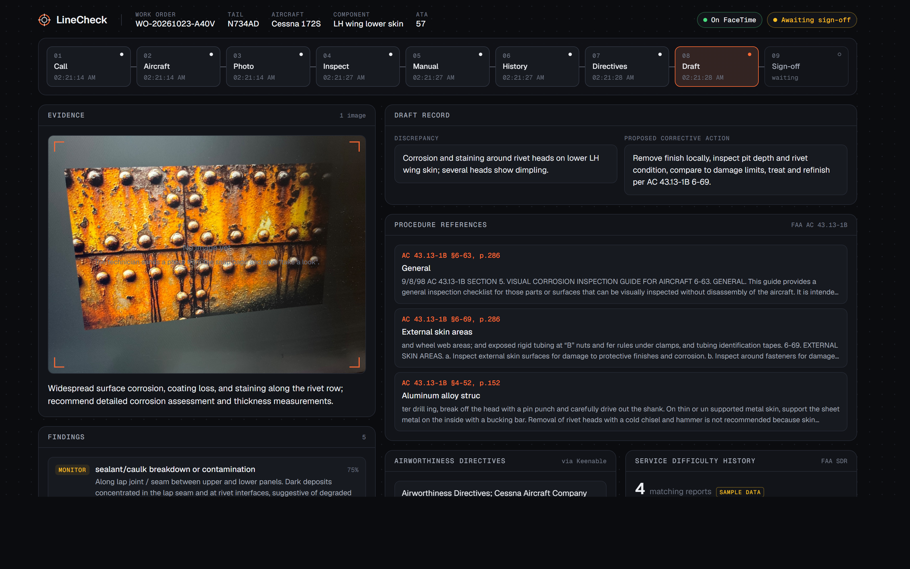
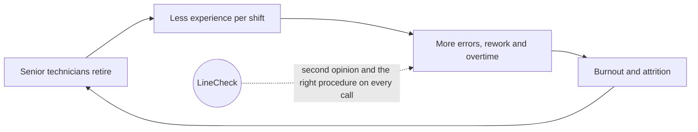
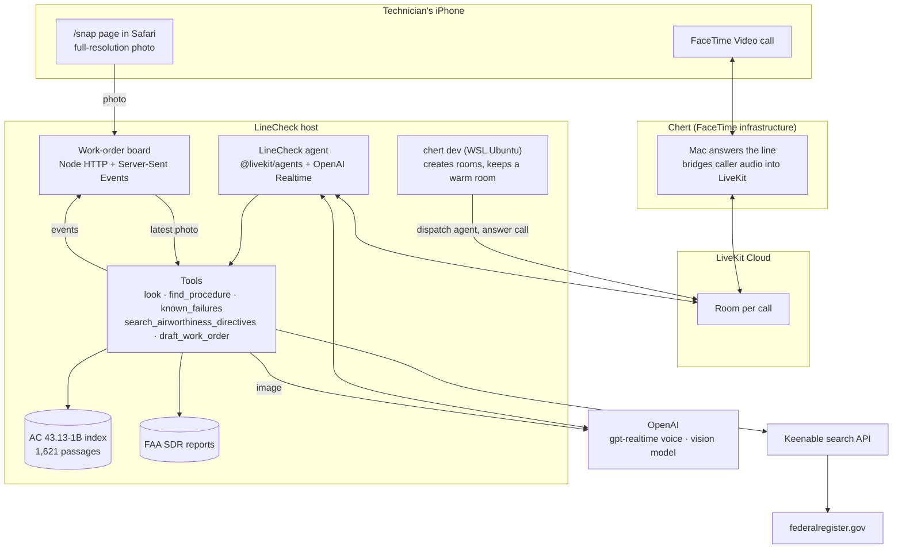
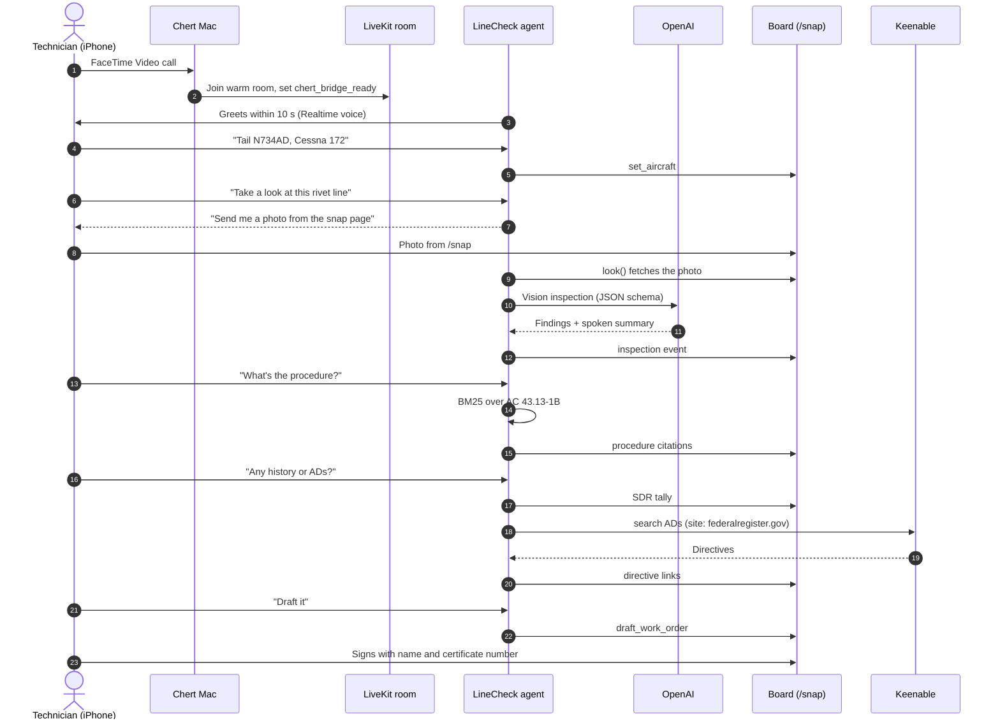

# LineCheck

**An AI inspector aircraft technicians call on FaceTime.**

A technician FaceTimes LineCheck with their hands still on the aircraft. LineCheck takes the tail number by voice, inspects a photo of the part, cites the exact section of the FAA repair manual, checks FAA service difficulty history and airworthiness directives, and drafts the work order. A certificated mechanic reviews the record and signs it. LineCheck assists and documents; it never approves an aircraft for return to service.

Built by **Paras Adlakha** and **Harshita Adlakha** for the **Beta Fund × AWS × OpenAI Multi-Model Hackathon**, October 23, 2026.



*The live work-order board after a real FaceTime call: the nine-step pipeline across the top, the inspected photo and findings on the left, the draft record, manual citations, airworthiness directives and service history on the right.*

**Contents:** [The hackathon](#the-hackathon) · [The problem](#the-problem) · [What LineCheck does](#what-linecheck-does) · [Architecture](#architecture) · [How a call works](#how-a-call-works) · [Partner technologies](#partner-technologies) · [Data and evidence](#data-and-evidence) · [Run it yourself](#run-it-yourself) · [Repository layout](#repository-layout) · [What we learned](#what-we-learned) · [Limitations and roadmap](#limitations-and-roadmap) · [Team](#team) · [References](#references)

---

## The hackathon

| | |
|---|---|
| **Event** | Beta Multi-Model Hackathon ([Luma page](https://luma.com/beta-79jb)) |
| **Date and place** | Friday, October 23, 2026 · AWS Builder Loft, San Francisco (we took part online) |
| **Hosts** | Beta Fund · [AWS](https://aws.amazon.com) · [OpenAI](https://openai.com) |
| **Partners** | [Keenable](https://keenable.ai) · [Chert](https://www.trychert.com) · [MatrAIx](https://personalagenteval.com) · [Nebius](https://nebius.com) |
| **Theme** | Products that reason across images, video, audio, voice, documents and real-world data: build something that can see, hear, understand and act |
| **Our track** | Multi-Modal Agents: agents that see, hear, reason and act across modalities |
| **Submission** | Three slides in the master deck (who you are, what you are solving, why your team) and a strict three-minute live demo |

**Judging criteria** (1 to 5 each, 25 total): Multi-Modal Depth, Technical Execution, Usefulness and Impact, Product and Shipability, Demo Clarity. Ties go to Technical Execution, then Multi-Modal Depth.

### What each partner asked for, and how LineCheck answers

| Partner | What they offered or asked for | How LineCheck uses it |
|---|---|---|
| **Chert** | Best Use of FaceTime prize: build on Chert's FaceTime API, submit a repo, a LinkedIn or X post, and a demo video of a live FaceTime call | The whole product is a FaceTime call. LineCheck is a LiveKit agent placed on a Chert FaceTime line with `chert dev`, and it greets on Chert's `chert_bridge_ready` signal |
| **Keenable** | Keenable Prize for the best use of its web search API for AI | Live airworthiness directive search during the call, pinned to the Federal Register where ADs are published (see [Keenable](#keenable-live-airworthiness-directive-search)) |
| **OpenAI** | Co-host; frontier multimodal models | `gpt-realtime` holds the spoken conversation and calls tools; a vision model inspects each photo and returns structured findings |
| **AWS** | Co-host and venue | Event host. LineCheck runs locally plus LiveKit Cloud for the hackathon; AWS deployment is on the roadmap |
| **Nebius** | Token Factory credits for open-source models | Not used in this build; a candidate for a self-hosted second-opinion vision model |
| **MatrAIx** | Open challenge: submit failure cases of generative models to Personal Agent Eval | Not entered |
| **Beta Fund** | Hosts; standout teams may be invited to the Beta Fund Fellowship | This repository and our three slides |

---

## The problem

Aircraft maintenance runs on experienced people, and there are not enough of them.

- The global commercial maintenance, repair and overhaul (MRO) market is about **$90 to 97 billion in 2026** (Visiongain; Precision Aviation Group).
- Oliver Wyman projects a shortage of **43,000 to 47,000 aircraft technicians by 2027**. North America alone is short about 17,000 mechanics, possibly 30,000 by 2028 (AVI-GO).
- In a study of **619 maintenance safety occurrences, 96% involved the actions of maintenance personnel**. Memory lapses were associated with fatigue, and rule violations with time pressure (Hobbs and Williamson, *Human Factors*, 2003).
- Errors tied to maintenance instructions appear as contributing or causal factors in US Part 121 and 135 accidents (Zimmermann et al., 2021).

The result is a reinforcing loop that our systems-dynamics background made obvious:



LineCheck targets the link from *less experience* to *more errors*: a second set of eyes and the correct manual reference on every call, on the phone a technician already carries.

---

## What LineCheck does

During one FaceTime call, LineCheck runs a nine-step pipeline. Each step lights up on the board as it happens.

| # | Step | What happens | Modality |
|---|---|---|---|
| 1 | **Call** | The technician FaceTimes the line; Chert answers and bridges the call into LiveKit | Voice |
| 2 | **Aircraft** | "Tail N734AD, Cessna 172." LineCheck records the aircraft | Voice to structured data |
| 3 | **Photo** | The technician sends a full-resolution photo from the `/snap` page on their phone | Image |
| 4 | **Inspect** | A vision model returns findings with severity, location, confidence and evidence | Vision |
| 5 | **Manual** | BM25 search over all 646 pages of FAA AC 43.13-1B returns the section and page | Document retrieval |
| 6 | **History** | FAA Service Difficulty Reports for the same aircraft and part | Structured data |
| 7 | **Directives** | Keenable searches the Federal Register for airworthiness directives | Live web search |
| 8 | **Draft** | Discrepancy and proposed corrective action, citing the procedure | Structured record |
| 9 | **Sign-off** | A certificated technician enters name and certificate number to sign | Human decision |

**The safety boundary.** LineCheck's instructions forbid it from ever saying a part or aircraft is airworthy, serviceable or safe to fly. Every record stays a draft until a person signs it. That boundary was the first design decision.

---

## Architecture



**Why it is built this way**

- **FaceTime, not an app.** No install, works with gloves on, runs on the device every technician already has.
- **LiveKit as the meeting room.** Chert's Mac and the LineCheck agent both join the same LiveKit room; LiveKit Cloud carries the audio between them. Nothing has to be opened in the LiveKit dashboard: `chert dev` creates the rooms and the agent connects outward.
- **Tools instead of one big prompt.** The realtime model handles conversation; each fact (a citation, a finding, a directive) comes from a tool, is logged on the board, and can be traced.
- **Photo upload alongside the call.** Chert's FaceTime bridge publishes the caller's audio but not the caller's camera, so the technician sends a full-resolution photo from `/snap`. The agent's `look` tool waits up to 25 seconds for it. A still photo also inspects better than a compressed video frame.
- **The board is the system of record.** Every tool posts an event; the board folds events into one work order (`core/workorder.mjs`) and streams it to the screen.

---

## How a call works



---

## Partner technologies

### Chert: the FaceTime line
- `chert dev --agent linecheck-adlakha --minutes 20` connects our LiveKit agent to a shared FaceTime line and keeps a warm room so calls are answered in about 0.1 s.
- The agent greets only on the `chert_bridge_ready` room-metadata signal, as Chert requires (`agent/greet.mjs`, from Chert's starter).
- The agent publishes exactly one audio track and one camera track: an inspection reticle whose colour shows what LineCheck is doing (`agent/scope.mjs`).

### LiveKit: the real-time transport
- `@livekit/agents` 1.8 with `@livekit/agents-plugin-openai`. The agent registers as a named worker; LiveKit dispatches it into each room `chert dev` creates.

### OpenAI: conversation and vision
- `gpt-realtime` (voice `marin`) runs the spoken conversation and decides when to call tools. Instructions pin English and the safety boundary.
- A vision model (`gpt-5-mini` by default, `VISION_MODEL` to change) returns findings through a strict JSON schema: component, image quality, findings with severity and confidence, recommended checks, and a short spoken summary (`core/vision.mjs`).

### Keenable: live airworthiness directive search
- `core/adsearch.mjs` calls `POST https://api.keenable.ai/v1/search` with `site: "federalregister.gov"`, because the FAA publishes airworthiness directives in the Federal Register. If that returns nothing, it widens to the open web.
- Results (title, URL, snippet, published date) go back to the voice agent, which tells the technician what looks relevant, and the links land on the work order next to the manual citations.
- Without a key it falls back to Keenable's keyless public endpoint.

---

## Data and evidence

| Source | What it is | How it is used |
|---|---|---|
| [FAA AC 43.13-1B](https://www.faa.gov/regulations_policies/advisory_circulars/index.cfm/go/document.information/documentID/99861) | *Acceptable Methods, Techniques, and Practices: Aircraft Inspection and Repair*, 646 pages | Indexed into 1,621 passages with section and page; searched with BM25 (`core/procedures.mjs`) |
| [FAA Service Difficulty Reports](https://www.faa.gov/av-info/download_SDR) | Malfunction and defect reports by aircraft and part | Normalised from CSV by header name (`core/failures.mjs`). The repo ships **clearly labelled sample rows**; the board tags them "sample data" until real CSVs are ingested |
| [Federal Register](https://www.federalregister.gov) | Where the FAA publishes airworthiness directives | Searched live through Keenable |

FAA.gov blocks scripted downloads, so the PDF and CSVs are downloaded in a browser into `data/raw/` and indexed with `npm run ingest`. They are not committed.

**Research behind the design**

| Finding | Source |
|---|---|
| 96% of 619 maintenance occurrences involved personnel actions; memory lapses linked to fatigue, violations to time pressure | Hobbs and Williamson, *Human Factors*, 2003 |
| Instruction-related errors contributed to US Part 121/135 accidents, 2003 to 2017 | Zimmermann et al., *Collegiate Aviation Review International*, 2021 |
| Interactive augmented instructions reduce execution time and error rate against paper manuals | Fiorentino et al., *Computers in Industry*, 2014 |
| AR assistance improves inspection performance and lowers mental workload, most on difficult tasks | Seeliger et al., *Computers in Industry*, 2023 |
| An LLM tuned with an aircraft ontology beat general GPT models at identifying defective components | Wang et al., *CIRP Annals*, 2024 |
| Vision-language models detect industrial anomalies from very few examples | Gu et al., AnomalyGPT, 2023 |

---

## Run it yourself

**Requirements:** Node 22.23+ or 24 · a [LiveKit Cloud](https://cloud.livekit.io) project · an OpenAI key with Realtime access · a [Keenable](https://keenable.ai) key (optional) · a [Chert](https://www.trychert.com) project with a FaceTime line · an iPhone signed in to FaceTime and iMessage. The Chert CLI runs on macOS or Linux only; on Windows, run it in WSL Ubuntu.

```bash
git clone https://github.com/ParasAdlakha/linecheck.git
cd linecheck
npm install
cp .env.example .env.local     # add LiveKit, OpenAI and Keenable keys, and a unique AGENT_NAME
npm test                       # 10 unit tests, no keys needed
```

**Index the real manual** (optional; sample passages are used until you do). Download AC 43.13-1B and any SDR CSVs into `data/raw/`, then:

```bash
npm run ingest
npm run ask -- procedure "corrosion around rivets on wing skin"
```

**Run a call.** Three terminals:

```bash
npm run board                  # 1. work-order board on http://localhost:8787
npm run agent:dev              # 2. the LineCheck agent
npx --yes @trychert/facetime@0.1.0-beta.10 dev --agent <AGENT_NAME> --minutes 20   # 3. macOS/Linux/WSL
```

Then FaceTime Video your line, open `http://<laptop-LAN-IP>:8787/snap` on the phone to send photos, and watch the board at `http://localhost:8787`.

**Rehearse without a call:**

```bash
npm run ask -- look photo.jpg "lower wing skin near rivet line"
npm run ask -- failures "Cessna 172" "skin corrosion"
npm run ask -- ads "Cessna 172" "wing skin corrosion"
```

---

## Repository layout

```
agent/
  agent.mjs        LiveKit agent: Realtime session, tools, greeting, reticle video track
  tools.mjs        The tools as plain functions (testable without LiveKit)
  scope.mjs        The reticle the caller sees, coloured by state
  greet.mjs        Greet on Chert's chert_bridge_ready signal (from Chert's starter)
core/
  procedures.mjs   BM25 search over manual passages, with citations
  failures.mjs     SDR CSV parser, header mapping and lookup
  adsearch.mjs     Keenable airworthiness directive search
  vision.mjs       OpenAI vision inspection with a strict JSON schema
  workorder.mjs    Folds call events into one work order
  board-client.mjs How the agent posts to the board
  png.mjs          Dependency-free PNG encoder for video frames
  config.mjs       Every setting in one place
board/
  server.mjs       HTTP + Server-Sent Events: board, /snap, events, sign-off
  public/          The board (node-canvas design) and the phone photo page
scripts/
  ingest.mjs       Builds the manual and SDR indexes from data/raw/
  ask.mjs          Runs any tool from the terminal
data/sample/       Clearly labelled sample passages and SDR rows
docs/              Screenshots used in this README
test/              Unit tests (node --test)
```

---

## What we learned

- **Chert's FaceTime bridge carries audio only into LiveKit.** The caller arrives with no video track, so `look` could never see the caller's camera. We moved the image to a `/snap` page and made `look` wait for it.
- **Clocks matter.** Chert declines calls when the machine's clock is more than a quarter second off. Windows ran 0.7 s fast and WSL inherits it, so `chert dev` runs with the WSL clock stepped to `time.google.com`. One public NTP server gave readings with a 2.5 s error from our network, so we verified against two.
- **Realtime voices mirror the caller's language.** The first test call drifted out of English; pinning English in the instructions fixed it.
- **Dark frames vanish on FaceTime.** Compression turned our near-black reticle into what looked like no picture; a mid-tone background fixed it.

---

## Limitations and roadmap

**Limitations today**
- Assists only. Findings are descriptive; nothing replaces the certificated technician's inspection and sign-off.
- Service difficulty history uses sample rows until real FAA CSVs are ingested. The board labels this clearly.
- Directive search returns Federal Register documents for the aircraft family; it does not yet filter by serial number or compliance status.
- One call at a time per Chert line; the agent and board run on one machine.

**Roadmap**
- Ingest the full SDR history and Airframe and Powerplant handbooks.
- Filter directives by make, model and serial; flag recurring ADs.
- Deploy the agent and board on AWS so no laptop is needed.
- Use Chert's iMessage channel to send photos directly to the line.
- Evaluate vision findings against labelled aircraft-skin defect datasets before any field use.

---

## Team

| | Background | Role on LineCheck |
|---|---|---|
| **Paras Adlakha** | Aerospace, electronics, systems engineering | Agent, vision and data pipeline |
| **Harshita Adlakha** | System dynamics, socio-technical systems | Research, human factors and product |

---

## References

- Hobbs, A. and Williamson, A. (2003). Associations between errors and contributing factors in aircraft maintenance. *Human Factors*.
- Zimmermann, N. et al. (2021). The impact of human factors and maintenance documentation on aviation safety. *Collegiate Aviation Review International*.
- Fiorentino, M. et al. (2014). Augmented reality on large screen for interactive maintenance instructions. *Computers in Industry*.
- Seeliger, A. et al. (2023). Augmented reality for industrial quality inspection. *Computers in Industry*.
- Wang, P. et al. (2024). Ontology-integrated tuning of large language model for intelligent maintenance. *CIRP Annals*.
- Gu, Z. et al. (2023). AnomalyGPT: Detecting industrial anomalies using large vision-language models.
- Market figures: [Visiongain](https://visiongain.com/report/commercial-aircraft-maintenance-market-2026/), [Precision Aviation Group](https://www.precisionaviationgroup.com/publications/aviation-mro-growth/), [Oliver Wyman](https://www.oliverwyman.com/our-expertise/insights/2026/apr/aviation-mro-labor-and-material-supply-chain-paradigm.html), [AVI-GO](https://ai.avi-go.com/news/ai-news-center/news-briefs/aviation-mro-sector-faces-acute-talent-shortage-as-global-spending-hea-dd075c0f67ca71384d9431d0e8694371). Vendor market reports differ by scope; we quote the conservative range.
- Tools: [Chert FaceTime CLI](https://www.trychert.com) · [LiveKit Agents](https://docs.livekit.io/agents/) · [OpenAI Realtime API](https://platform.openai.com/docs/guides/realtime) · [Keenable API](https://docs.keenable.ai)

---

*LineCheck is a hackathon prototype for research and demonstration. It is not approved data for maintenance decisions. Always follow the manufacturer's instructions and applicable FAA regulations.*
